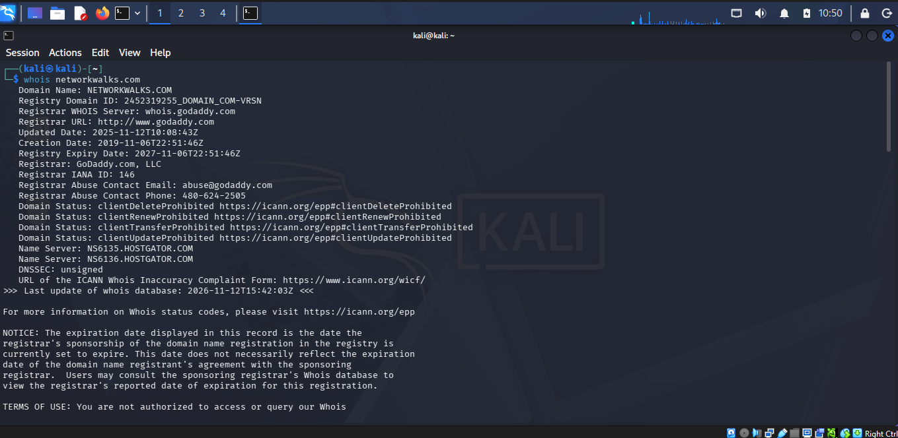
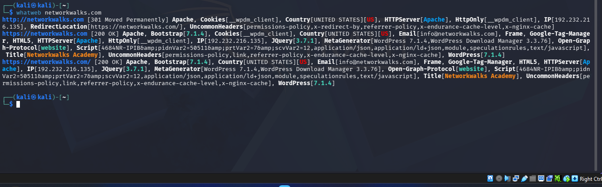
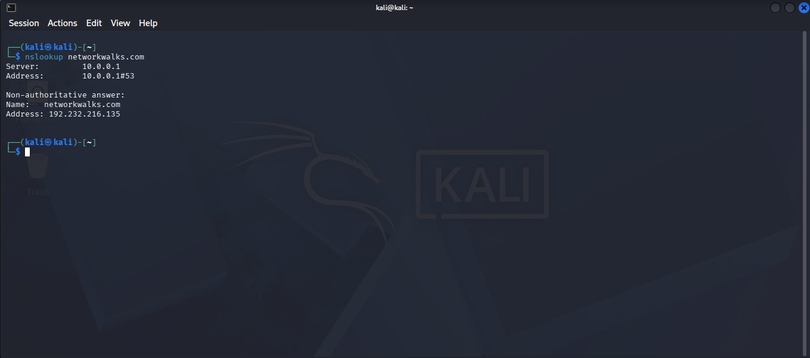
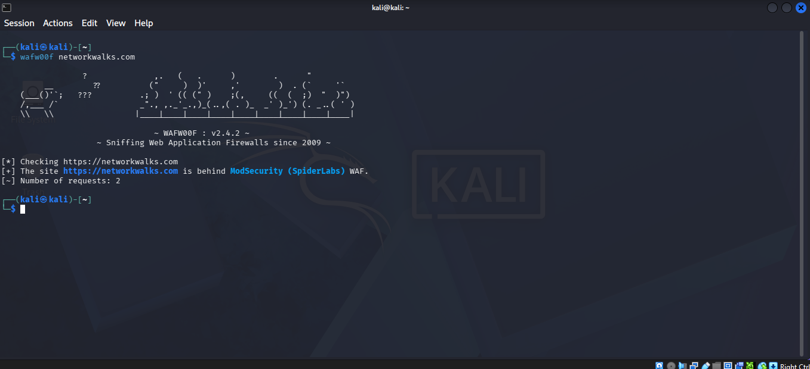
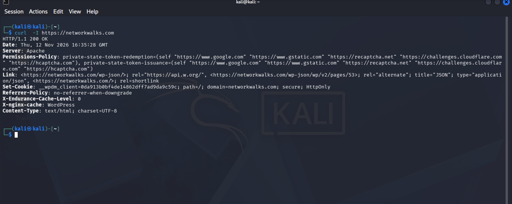
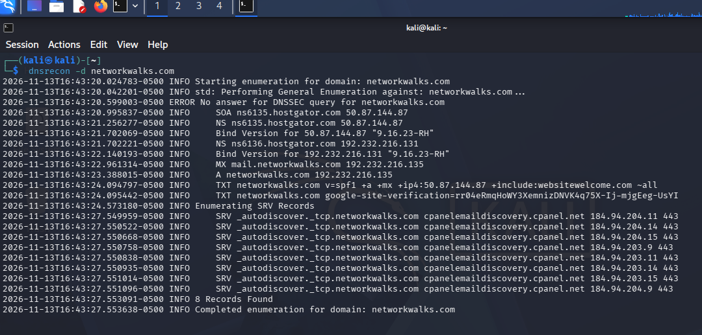
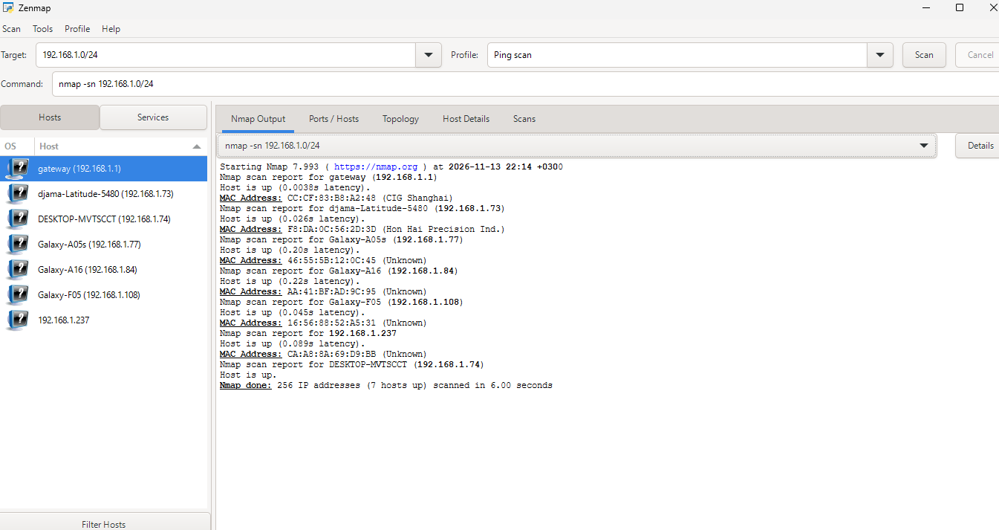
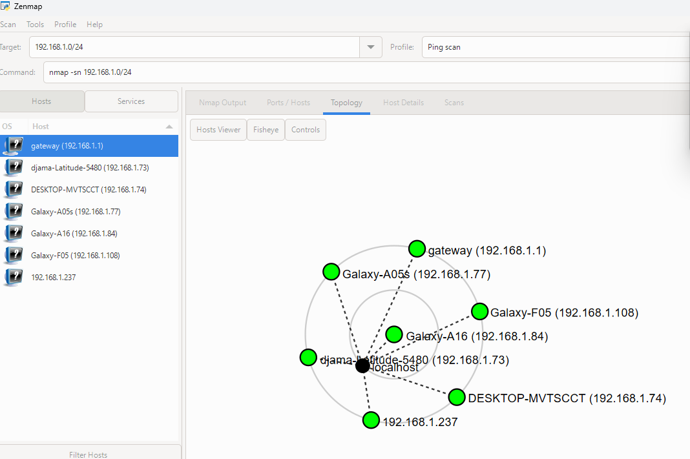

# NETWORKWALKS-Djama-B084-WK2-PM1-PM5-CYBERSECURITY-LAB-SETUP

| Field | Detail |
|---|---|
| **Pentester Name (Cybersecurity Professional)** | **Djama Dayib Ahmed** |
| **Program/Batch** | B084-Networkwalks |
| **Date** | 14 November 2026 |
| **Modules completed** | W2-PM1 (Multiple Kali Tools(Footrprinting)) W2-PM5 (Zenmap Scanning) |
| **Client/Target** | 1. Networkwalks (secured written permission already) 2. My own local LAN Network |
| **Permission secured from client?** | Yes |
| **Phases covered** | **Phase 1:** Reconnaissance & Footprinting **Phase 2:** Scanning & Network Discovery|
## Project Overview

 Week 2 practical activities as part of the Networkwalks Cybersecurity .

The project focuses on two key phases of penetration testing: footprinting and reconnaissance, followed by network scanning and host discovery.

# 1. Liability Disclaimer
I have conducted these activities only on systems and devices that I own or for which I have obtained written permission. This material is provided for educational and research purposes only. Do not use it to break the law.
The instructor, authors, and Networkwalks are not responsible for how you use this knowledge. You are responsible for your own actions. Misuse may result in criminal charges, substantial fines, loss of employment, and a permanent record. In many countries, unauthorized access is a crime—even if no damage is caused.

# 2. Introduction
This report documents two Week 2 internship activities at Networkwalks: footprinting the networkwalks.com domain using Kali Linux tools (W2-PM1) and scanning my own local network with Zenmap (W2-PM5). Together, these activities demonstrate how publicly available information can be collected and how authorized network scanning can identify live hosts.
Footprinting was conducted in Kali Linux, and the local network scan was performed on a Windows PC using Zenmap. For each step, the report includes the command used, the observed result, a screenshot for evidence, and a brief explanation of the finding’s relevance to security assessment.

# 3. Tools Used
The table below lists each tool used in this report and its purpose.

| Tool | Purpose |
|---|---|
| Kali Linux & Windows | Operating systems used for reconnaissance activities             |
| WHOIS                | Find domain registration details (owner, dates, name servers).   |
| whatweb              | Fingerprint web technologies (server, CMS, plugins, IP).         |
| nslookup             | Resolve the domain name to its IP address using DNS.             |
| curl -I              | Read the HTTP response headers of the website.                   |
| wafw00f              | Detect whether a Web Application Firewall protects the site.     |
| dnsrecon             | Enumerate all DNS records (NS, MX, SPF, TXT, SRV).               |
| Zenmap (Nmap GUI)    | Scan the local subnet to find live hosts, IPs and MAC addresses. |
| Windows CMD          | Local IP and MAC address identification                          |

# 4. Activities Performed
## 4.1 Footprinting & Reconnaissance
I performed reconnaissance against the networkwalks.com domain using six Kali Linux tools: WHOIS, WhatWeb, Nslookup, Curl, Wafw00f and DNSRecon. Each tool was used to collect a different type of information about the target.
First, I used WHOIS to obtain publicly available domain registration information and identify the domain’s name servers. The results provided information about the domain registration and hosting infrastructure.
I then used WhatWeb to identify technologies used by the website. The results identified WordPress 7.1.4 and WP Download Manager 3.3.76, along with other information exposed by the website.
Using Nslookup, I resolved the domain name to its IP address. The provided result identified 192.232.216.135.
I used Curl with the -I option to inspect the HTTP response headers. This provided additional information about the web application and exposed the WordPress REST API endpoint /wp-json/.
Next, I used Wafw00f to determine whether a Web Application Firewall was protecting the website. The result identified ModSecurity (SpiderLabs).
Finally, I used DNSRecon to enumerate DNS records. The results provided information relating to name servers, mail servers, SPF/TXT records, service records and DNS software information.

## 4.2 Network Scanning with Zenmap
For the second activity, I used Zenmap to perform authorized host discovery on my local network. The objectives were to identify my computer’s local IP address and subnet, discover active hosts, record their IP and MAC addresses where available, and generate a network topology view.
I first ran ipconfig in Windows Command Prompt to find my computer’s local IPv4 address and subnet mask. I used this information to determine the local subnet, then entered the subnet in Zenmap and selected Ping Scan to check for active hosts. I reviewed the scan results for host IP addresses and, where available, MAC addresses, and used Zenmap’s topology view to visualize the discovered devices.
The example results provided in the practical identified four live hosts:
- `192.168.1.1`
-	`192.168.1.77`
-	`192.168.1.108`
-	`192.168.1.84`
-	`192.168.1.73`
-	`192.168.1.74`
-	`192.168.1.237`.

The example results also included six MAC addresses.
After completing the scan, I opened the Topology section in Zenmap, enabled the legend and saved the network topology in PDF format as required by the practical task.
# 5. Risk Analysis / Impact

Based on the information collected during the footprinting and network scanning activities, I identified the following potential risks.

| **\#** | **Risk / Finding**                           | **Evidence / Observation**                                  | **Potential Impact**                                                                                            | **Risk Level** |
|--------|----------------------------------------------|-------------------------------------------------------------|-----------------------------------------------------------------------------------------------------------------|----------------|
| 1      | Web technology information exposed           | WhatWeb identified WordPress and WP Download Manager        | Attackers may use exposed technology/version information to identify software requiring further security review | **● Medium**   |
| 2      | Server IP address identifiable               | Nslookup resolved the domain to `192.232.216.135`           | Provides information about the network location of the web service                                              | **● Low**      |
| 3      | HTTP technical information exposed           | Curl returned HTTP response headers and exposed `/wp-json/` | May assist technology fingerprinting and further enumeration                                                    | **● Low**      |
| 4      | WAF technology identifiable                  | Wafw00f identified ModSecurity (SpiderLabs)                 | Reveals information about the web application’s security architecture                                           | **● Low**      |
| 5      | DNS infrastructure information exposed       | DNSRecon identified DNS, mail and service-related records   | DNS information can help build a broader infrastructure profile                                                 | **● Medium**   |
| 6      | Multiple live hosts visible on local network | Zenmap identified four live hosts in the example network    | Unknown or unauthorized devices may potentially be present on a network                                         | **● Medium**   |

**Risk level key:** ● Critical ● Medium ● Low

The risks above are observations from the footprinting and scanning exercises, not confirmed vulnerabilities.

The practical exercises primarily involved information gathering and host discovery. No exploitation or vulnerability validation was performed as part of these two modules.

Therefore, the presence of information such as a software version, IP address or DNS record does not by itself mean that the system is vulnerable. Further authorized security testing would be required to confirm any actual vulnerability.

# 6. Recommendations

Based on the observations from these activities, I recommend the following security improvements:

1.  **Review publicly exposed technology information**  
    Organizations should regularly review what information about their web technologies, CMS and plugins is publicly visible.

2.  **Keep software updated**  
    CMS platforms, plugins and other web technologies should be regularly updated and reviewed against current security advisories.

3.  **Review HTTP headers**  
    HTTP response headers should be reviewed to determine whether unnecessary technical information is being exposed.

4.  **Review DNS records regularly**  
    DNS records should be checked periodically to ensure that only required information and services are publicly exposed.

5.  **Properly configure and monitor the WAF**  
    Keep the WAF (ModSecurity) enabled and tuned, since it already blocks naive attacks.

6.  **Perform regular internal network discovery**  
    Organizations should periodically scan their own networks to identify active devices.

7.  **Investigate unknown devices**  
    Any unexpected device discovered during network scanning should be investigated and verified.

8.  **Maintain network documentation**  
    Network topology and device information should be documented and updated regularly.

9.  **Perform security testing with authorization**  
    Reconnaissance and scanning should only be performed against systems and networks where appropriate authorization has been provided.

# 7. Conclusion

During Week 2 of my Cybersecurity and Ethical Hacking internship, I completed practical activities in footprinting, reconnaissance, and network scanning.
For the footprinting activity, I used six Kali Linux tools to gather information about the target domain. I learned how WHOIS can reveal domain registration details, WhatWeb can identify web technologies, nslookup can resolve domain names, curl can inspect HTTP headers, Wafw00f can help identify a web application firewall, and DNSRecon can gather additional DNS information.
For the network scanning activity, I used Zenmap to identify my local network configuration and discover active hosts. I also reviewed available IP and MAC address information and created a network topology.
These exercises demonstrated the value of information gathering in cybersecurity. By analyzing publicly available information and network responses, security professionals can build an understanding of an environment before conducting further assessment. I also learned the importance of documenting findings clearly: a useful report explains what was done, what was observed, why it matters, what risks may be involved, and how those risks could be reduced.
Finally, I learned that reconnaissance and scanning must remain within an explicitly authorized scope. I completed these activities as part of the assigned educational cybersecurity lab.

# 8. Evidences Collected
*Screenshots collected performing the above task:

Thanks 
End Fin 

